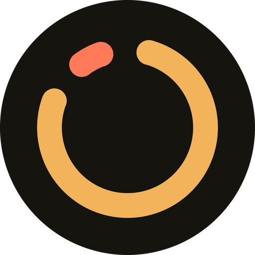
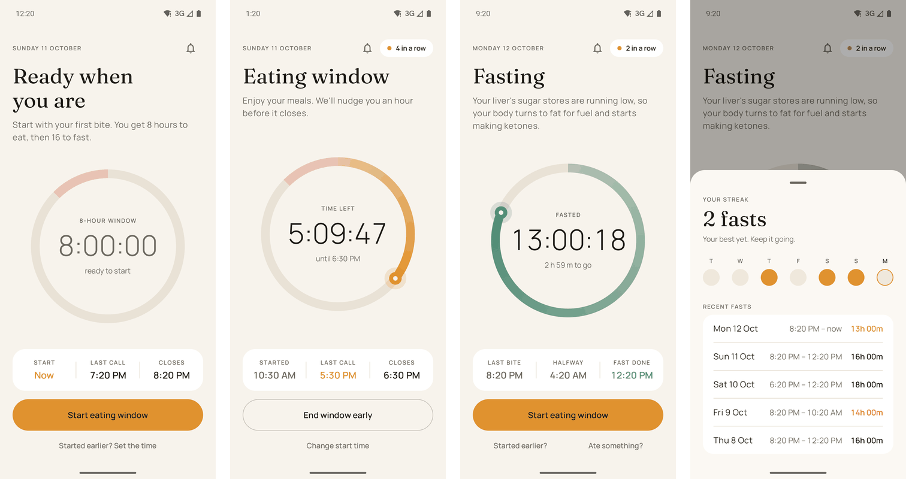

# Eating Window

[](https://github.com/ctjerm/eating-window/actions/workflows/build.yml)
[](LICENSE)


An Android app for 16:8 intermittent fasting. Tap when you take your first bite: you get an
8-hour eating window, then the app follows the 16-hour fast after it, which is the part that counts.



## What it does

- **Eating window.** A ring counts down 8 hours. "Last call" comes at 7 hours and "Kitchen's
  closed" at 8.
- **Fast.** A silent live countdown runs in the notification shade. The screen says what your
  body is doing at that stage, and "Fast complete" arrives at 16 hours with a Start now button.
- **Streak of completed fasts.** A fast counts once it reaches 16 hours. Starting a window early
  asks first, then records the fast as short.
- **Corrections.** Set the time you really started, end a window early, or log a late snack with
  "Ate something?", which restarts the fast from then.
- **Daily start nudge.** An optional reminder at your usual start time.
- **Quick Settings tile.** Shows the end of the window or fast. Once the fast is done, a tap starts
  the next window without opening the app.
- **History.** The past week and your recent fasts.

There is no account and no server. Your windows and fasts are stored on the phone only.

## Build

Requires Android 8.0 (API 26) or later. Open the project in Android Studio, or use JDK 17+ with the
Android SDK:

```bash
./gradlew installDebug
```

```bash
./gradlew testDebugUnitTest
```

## How the code is laid out

| File | Responsibility |
|---|---|
| `EatingWindow.kt` | Timing rules for the window, the fast and its stages |
| `History.kt` | Past windows, the fasts between them, and the streak |
| `DailyStart.kt` | When the daily nudge is due |
| `Reminders.kt` | Stored state, alarms, and re-arming after a reboot |
| `Notifications.kt` | The single notification slot the day moves through |
| `StartTile.kt` | Quick Settings tile |
| `ui/` | Jetpack Compose screens |

The first three are plain Kotlin with no Android dependencies, covered by JUnit tests in
`app/src/test`.

## Notes

- Alarms use `setAlarmClock` because ColorOS delays ordinary exact alarms by up to 75 % of
  their delay. The cost is an alarm icon in the status bar. See
  [docs/api/android](docs/api/android/coloros-and-android16-notes.md).
- The fasting stage text sticks to what human studies show. The sources are noted next to the
  copy in `ui/WindowScreen.kt`. This app is not medical advice. If you are pregnant, have
  diabetes, or have a history of eating disorders, check with a doctor before fasting.

## License

The code is [MIT](LICENSE). The bundled fonts, Fraunces and Manrope, are under the SIL Open Font
License 1.1; see [licenses/](licenses).
